# Database Design — Life Events

Status: **Accepted** · Last updated: 2026-10-14 · Owner: Backend lead
Source of truth: `prisma/schema.prisma` (29 models, 14 enums) and `prisma/migrations/**`.
Companion documents: [system-design](./system-design.md), [security](./security.md),
[testing-strategy](./testing-strategy.md), [implementation-plan](./implementation-plan.md).

> Snapshot note (2026-10-14 18:15): this describes the schema as committed. The HTTP boundary now
> exists (`src/app/api/**`), so index justifications reference shipped service, repository and route
> queries; indexes with no attributable query are flagged in §3.

## 1. Entity-relationship overview

```mermaid
erDiagram
    User ||--o{ Session : "has"
    User ||--o{ Account : "has"
    User ||--o| CustomerProfile : "has"
    User ||--o{ BusinessListing : "created"
    User ||--o{ Enquiry : "customer or assignee"
    User ||--o{ EnquiryListing : "assignee"

    Location ||--o{ Location : "parent"
    Location ||--o{ BusinessListing : "primary"
    Location ||--o{ ListingServiceArea : "serves"
    Location ||--o{ CustomerProfile : "profileCity"
    Location ||--o{ Enquiry : "contactCity"

    Category ||--o{ Category : "parent"
    Category ||--o{ BusinessListing : "primary"
    Category ||--o{ ListingCategory : "linked"
    Category ||--o{ CategoryAttribute : "binds"
    AttributeDefinition ||--o{ CategoryAttribute : "boundVia"
    AttributeDefinition ||--o{ AttributeOption : "options"
    AttributeDefinition ||--o{ ListingAttributeValue : "valuedBy"
    AttributeOption ||--o{ ListingAttributeValue : "singleOption"
    AttributeOption }o--o{ ListingAttributeValue : "multiOptions"

    EventType ||--o{ ListingEventType : "linked"
    EventType ||--o{ Enquiry : "eventType"
    Amenity ||--o{ ListingAmenity : "linked"

    BusinessListing ||--o{ ListingCategory : "categories"
    BusinessListing ||--o{ ListingEventType : "eventTypes"
    BusinessListing ||--o{ ListingServiceArea : "serviceAreas"
    BusinessListing ||--o{ ListingMedia : "media"
    BusinessListing ||--o{ ListingService : "services"
    BusinessListing ||--o{ ListingPackage : "packages"
    BusinessListing ||--o{ VenueSpace : "spaces"
    BusinessListing ||--o{ ListingAttributeValue : "attributes"
    BusinessListing ||--o{ ListingAmenity : "amenities"
    BusinessListing ||--o{ EnquiryListing : "leads"

    Enquiry ||--o{ EnquiryListing : "leads"
    Enquiry ||--o{ EnquiryActivity : "history"
    Enquiry ||--o{ EnquiryNote : "notes"
    EnquiryListing ||--o{ EnquiryActivity : "history"
    EnquiryListing ||--o{ EnquiryNote : "notes"
```

### Clusters

**Identity and access** (`User`, `Session`, `Account`, `Verification`, `CustomerProfile`) follow the
Better Auth Prisma adapter's shape, with application columns (`role`, `status`, moderation fields) on
`User`. Sessions are database rows so a suspension or role change takes effect on the next request
rather than at token expiry (ADR-3). `CustomerProfile` is separate and optional, keeping
authentication data and marketplace preferences decoupled.

**Geography** (`Location`) is one self-referencing tree (`COUNTRY → STATE → CITY → LOCALITY`) with a
materialised `path`; descendants are found by `path` prefix — a single indexed range scan
(`resolveLocationSubtreeIds`, `src/server/services/catalog.service.ts`).

**Catalogue and attributes** (`Category`, `EventType`, `AttributeDefinition`, `CategoryAttribute`,
`AttributeOption`, `Amenity`) is the configuration layer. There is no per-category table:
`CategoryAttribute` binds one global `AttributeDefinition` to many categories with different
behaviour, which is what makes "a new category without rebuilding the app" a data operation.

**Listings** (`BusinessListing` plus every `Listing*` child) is one generic provider entity for every
category, with universal commercial fields as real columns and category-specific fields in
`ListingAttributeValue`.

**Enquiries** (`Enquiry`, `EnquiryListing`, `EnquiryActivity`, `EnquiryNote`) model one shared event
brief with one independent lead per provider. `Enquiry.status` is derived from its children and
denormalised for indexing (ADR-9).

**Administration and abuse control** (`AuditLog`, `RateLimitBucket`, `IdempotencyKey`) holds the
append-only audit trail, the fixed-window rate limiter and the replay-protection table — all in
PostgreSQL because serverless instances share no memory (ADR-10).

## 2. Models

### 2.1 Identity

| Model             | Purpose                                                       | Key columns                                                                              | Notable constraints                                                                                                                |
| ----------------- | ------------------------------------------------------------- | ---------------------------------------------------------------------------------------- | ---------------------------------------------------------------------------------------------------------------------------------- |
| `User`            | One row per human: customers and administrators.              | `email` (unique), `role`, `status`, `banned`, `banReason`, `banExpires`, `emailVerified` | `role`/`status` are server-owned (`input: false` in `src/lib/auth/server.ts`). `@@index([role, status])`.                          |
| `Session`         | Database session; the only source of authentication.          | `token` (unique), `userId`, `expiresAt`, `ipAddress`, `userAgent`                        | `user` is `onDelete: Cascade` — deleting an account ends its sessions. `@@index([userId])`, `@@index([expiresAt])`.                |
| `Account`         | Better Auth credential/identity row; holds the password hash. | `providerId`, `accountId`, `password`                                                    | `@@unique([providerId, accountId])`, `@@index([userId])`. `user` is `Cascade`.                                                     |
| `Verification`    | Short-lived tokens for future email verification/reset.       | `identifier`, `value`, `expiresAt`                                                       | `@@index([identifier])`. Not currently used — email verification is not implemented.                                               |
| `CustomerProfile` | Optional marketplace preferences.                             | `userId` (unique), `phone`, `cityId`, `preferredContactMethod`, `marketingConsent`       | `user` Cascade (a profile without an account is meaningless); `city` **`SetNull`** — deleting a city must not delete the customer. |

### 2.2 Geography

| Model      | Purpose                      | Key columns                                                                                                             | Notable constraints                                                                                                                                                                                                                |
| ---------- | ---------------------------- | ----------------------------------------------------------------------------------------------------------------------- | ---------------------------------------------------------------------------------------------------------------------------------------------------------------------------------------------------------------------------------- |
| `Location` | Self-referencing place tree. | `slug` (globally unique), `name`, `type`, `path` (unique), `parentId`, `isActive`, `latitude`, `longitude`, `sortOrder` | `parent` is **`Restrict`**: a city with children cannot be deleted, which is what stops an accidental cascade wiping a subtree. `slug` is globally unique (migration `20261014124600`) so one clean URL segment addresses a place. |

### 2.3 Catalogue and attributes

| Model                 | Purpose                                                          | Key columns                                                                                                                                  | Notable constraints                                                                                                                |
| --------------------- | ---------------------------------------------------------------- | -------------------------------------------------------------------------------------------------------------------------------------------- | ---------------------------------------------------------------------------------------------------------------------------------- |
| `Category`            | Self-referencing category tree; subcategories are just children. | `slug` (unique), `path` (unique), `parentId`, `isActive`, `sortOrder`                                                                        | `@@unique([parentId, slug])` and `parent` `Restrict`. No `Subcategory` table.                                                      |
| `EventType`           | Wedding, reception, corporate, etc.                              | `slug` (unique), `isActive`, `sortOrder`                                                                                                     | Referenced by listings and enquiries.                                                                                              |
| `AttributeDefinition` | Global attribute catalogue (`capacity`, `style`, …).             | `code` (unique), `label`, `dataType`, `unit`, `minNumber`, `maxNumber`, `maxLength`, `isGlobal`                                              | `@@index([dataType])`; typed value columns are chosen from `dataType`.                                                             |
| `CategoryAttribute`   | Per-category binding: what the attribute _means here_.           | `isRequired`, `isFilterable`, `isSearchable`, `isVisibleOnProfile`, `isComparable`, `showOnCard`, `filterControl`, `groupLabel`, `sortOrder` | `@@unique([categoryId, attributeId])`; both FKs **`Cascade`** so removing a category or a definition cannot leave orphan bindings. |
| `AttributeOption`     | Allowed values for single/multi-select attributes.               | `value` (`VarChar(64)`), `label`, `isActive`, `sortOrder`                                                                                    | `@@unique([attributeId, value])`; `attribute` `Cascade`.                                                                           |
| `Amenity`             | Normalised amenity/tag catalogue shared across categories.       | `code` (unique), `label`, `groupLabel`, `isActive`                                                                                           | Used instead of free-text tags so amenities stay displayable and filterable.                                                       |

### 2.4 Listings

| Model                   | Purpose                                                 | Key columns                                                                                                                                                                                                                                     | Notable constraints                                                                                                                                                                                                                                                 |
| ----------------------- | ------------------------------------------------------- | ----------------------------------------------------------------------------------------------------------------------------------------------------------------------------------------------------------------------------------------------- | ------------------------------------------------------------------------------------------------------------------------------------------------------------------------------------------------------------------------------------------------------------------- |
| `BusinessListing`       | The generic provider entity for every category.         | `slug` (unique), `primaryCategoryId`, `primaryLocationId`, `publicationStatus`, `verificationStatus`, `isFeatured`, `publishedAt`, `archivedAt`, `priceMin/Max/Unit`, `capacityMin/Max`, `contact*`, `show*` flags, `searchText`, `createdById` | `primaryCategory` and `primaryLocation` are **`Restrict`** — deleting a category or location must not silently delete listings; `createdBy` is **`SetNull`** so deleting a staff account keeps the listing. Eight B-tree indexes plus a trigram GIN index (see §3). |
| `ListingCategory`       | Many-to-many listing↔category; exactly one `isPrimary`. | `isPrimary`, `sortOrder`                                                                                                                                                                                                                        | `@@unique([listingId, categoryId])`. "Exactly one primary" is enforced in the listing service inside a transaction because PostgreSQL cannot express it portably as a partial unique index through Prisma migrations.                                               |
| `ListingEventType`      | Listing↔event type.                                     | —                                                                                                                                                                                                                                               | `@@unique([listingId, eventTypeId])`; both FKs `Cascade`.                                                                                                                                                                                                           |
| `ListingServiceArea`    | Locations a listing says it serves.                     | —                                                                                                                                                                                                                                               | `@@unique([listingId, locationId])`. The `location` FK is `Cascade` (a service area is a link, not a record).                                                                                                                                                       |
| `ListingMedia`          | Verified image metadata; bytes live in R2.              | `storageKey` (unique), `publicUrl`, `altText`, `kind`, `status`, `mimeType`, `sizeBytes`, `width`, `height`, `blurDataUrl`, `sortOrder`, `isCover`, `failureReason`, `uploadedById`                                                             | `listing` `Cascade`; `uploadedBy` **`SetNull`** — a departed staff member's account deletion must not remove the listing's photos.                                                                                                                                  |
| `ListingService`        | Named service with its own price range.                 | `name`, `priceFrom`, `priceTo`, `priceUnit`, `durationMinutes`, `includes` (`String[]`), `isActive`, `sortOrder`                                                                                                                                | `listing` `Cascade`. Replaced wholesale by the admin editor.                                                                                                                                                                                                        |
| `ListingPackage`        | Curated package with inclusions/exclusions.             | `price`, `priceUnit`, `minGuests`, `maxGuests`, `inclusions`, `exclusions`                                                                                                                                                                      | `listing` `Cascade`.                                                                                                                                                                                                                                                |
| `VenueSpace`            | Optional venue-specific hall/lawn/poolside.             | `capacitySeated`, `capacityStanding`, `areaSqft`, `isIndoor`, `isOutdoor`, `layoutOptions`                                                                                                                                                      | Modelled as an optional child of _any_ listing rather than a separate venue entity.                                                                                                                                                                                 |
| `ListingAttributeValue` | One row per (listing, attribute) with typed columns.    | `valueText`, `valueNumber`, `valueBoolean`, `valueDate`, `optionId`, `optionIds` (`text[]`)                                                                                                                                                     | `@@unique([listingId, attributeId])`; `listing`/`attribute` `Cascade`; `option` **`SetNull`** so deleting an option does not delete the listing's value (the mirrored `valueText` label survives).                                                                  |
| `ListingAmenity`        | Listing↔amenity.                                        | —                                                                                                                                                                                                                                               | `@@unique([listingId, amenityId])`; both FKs `Cascade`.                                                                                                                                                                                                             |

### 2.5 Enquiries

| Model             | Purpose                                                                              | Key columns                                                                                                                                                                                                                                                                                                                               | Notable constraints                                                                                                                                                                                                                                                                                                                                                |
| ----------------- | ------------------------------------------------------------------------------------ | ----------------------------------------------------------------------------------------------------------------------------------------------------------------------------------------------------------------------------------------------------------------------------------------------------------------------------------------- | ------------------------------------------------------------------------------------------------------------------------------------------------------------------------------------------------------------------------------------------------------------------------------------------------------------------------------------------------------------------ |
| `Enquiry`         | The shared customer event brief.                                                     | `referenceCode` (unique), `customerUserId`, `contactName/Email/Phone`, `contactPhoneNormalised`, `contactCityId`, `eventTypeId`, `eventDate`, `guestCount`, `budgetMin/Max`, `requirements`, `status`, `isPotentialDuplicate`, `assignedAdminId`, `consentPrivacy`, `consentPolicyVersion`, `consentedAt`, `submittedIpHash`, `userAgent` | `customer` is **`SetNull`** — deleting an account must not destroy lead history. `assignedAdmin`, `contactCity` and `eventType` are `SetNull` for the same reason (reference data deletion must not delete leads). The `contactPhoneNormalised` column is the digits-only match key for duplicate detection.                                                       |
| `EnquiryListing`  | A single provider lead with its own status, assignee and SLA timestamps.             | `status`, `assignedAdminId`, `assignedAt`, `firstContactedAt`, `sharedWithProviderAt`, `convertedAt`, `lostAt`, `lostReason`, `providerResponseNote`, `sortOrder`                                                                                                                                                                         | `enquiry` `Cascade` (a lead without its brief is meaningless). `listing` is **`Restrict`** — _a listing that has ever received a lead cannot be deleted_, because deleting it would either destroy the lead or leave it pointing at nothing. `assignedAdmin` `SetNull`. `@@unique([enquiryId, listingId])` prevents two leads to the same provider in one enquiry. |
| `EnquiryActivity` | Append-only lead history; one row per status change, assignment, note or disclosure. | `type`, `fromStatus`, `toStatus`, `message`, `isCustomerVisible`, `actorUserId`, `actorName`, `metadata` (JSONB)                                                                                                                                                                                                                          | `enquiry` and `enquiryListing` `Cascade`; `actor` `SetNull` (activity outlives the actor account). `isCustomerVisible` is the single switch that decides whether an entry may cross into the customer projection.                                                                                                                                                  |
| `EnquiryNote`     | Private internal notes.                                                              | `body`, `authorUserId`, `authorName`                                                                                                                                                                                                                                                                                                      | `enquiry` and `enquiryListing` `Cascade`; `author` `SetNull`. Never selected by a customer-facing query.                                                                                                                                                                                                                                                           |

### 2.6 Administration and abuse control

| Model             | Purpose                                       | Key columns                                                                                                          | Notable constraints                                                                                                                                   |
| ----------------- | --------------------------------------------- | -------------------------------------------------------------------------------------------------------------------- | ----------------------------------------------------------------------------------------------------------------------------------------------------- |
| `AuditLog`        | Append-only record of administrative actions. | `action`, `entityType`, `entityId`, `summary`, `actorUserId`, `actorName`, `metadata` (JSONB), `ipHash`, `userAgent` | `actor` **`SetNull`** — the audit trail must survive the actor's deletion. `action` is a `String`, not a database enum; see §6.                       |
| `RateLimitBucket` | Fixed-window counters.                        | `key`, `windowStart`, `count`, `expiresAt`                                                                           | `@@unique([key, windowStart])` is the concurrency primitive: `consumeRateLimit` does one atomic upsert (`src/server/services/rate-limit.service.ts`). |
| `IdempotencyKey`  | Replay protection for enquiry submission.     | `key`, `scope`, `requestHash`, `enquiryId`, `expiresAt`                                                              | `@@unique([scope, key])` **is** the mechanism — a single `INSERT` decides the winner, never a `SELECT`-then-`INSERT` (`claimIdempotencyKey`).         |

### 2.7 Deletion behaviour, in one table

| Relation(s)                                                                                                                                                            | `onDelete`     | Why                                                                                                                                                      |
| ---------------------------------------------------------------------------------------------------------------------------------------------------------------------- | -------------- | -------------------------------------------------------------------------------------------------------------------------------------------------------- |
| `Session.user`, `Account.user`, `CustomerProfile.user`; `Listing*` children; `_ValueOptions`; `EnquiryListing.enquiry`; `EnquiryActivity`/`EnquiryNote` → enquiry/lead | `Cascade`      | Pure identity children, listing-owned rows, and lead history that cannot exist without its brief.                                                        |
| `Location.parent`, `Category.parent`, `BusinessListing.primaryCategory`/`.primaryLocation`                                                                             | `Restrict`     | Prevents a subtree wipe, and a category/city deletion must not delete real listing content.                                                              |
| `EnquiryListing.listing`                                                                                                                                               | **`Restrict`** | A listing with leads cannot be deleted; the lead history is the business record.                                                                         |
| `BusinessListing.createdBy`, `ListingMedia.uploadedBy`                                                                                                                 | `SetNull`      | Staff turnover must not remove listings or their photos.                                                                                                 |
| `CustomerProfile.city`; `Enquiry.customerUserId`, `.assignedAdminId`, `.contactCityId`, `.eventTypeId`; `ListingAttributeValue.option`                                 | `SetNull`      | Reference-data or account deletion must not delete customers, destroy lead history, or delete a listing's attribute value (its mirrored label survives). |
| `EnquiryListing.assignedAdmin`, `EnquiryActivity.actor`, `EnquiryNote.author`, `AuditLog.actor`                                                                        | `SetNull`      | Assignment is operational; history and audit must outlive the account.                                                                                   |

## 3. Indexes

Every row below was read from `prisma/schema.prisma`; the migration that physically creates it is
`20261014122625_init` unless noted. "Query served" names the function or file.

### 3.1 Identity and geography

All declared in `prisma/schema.prisma` unless noted.

| Model — indexes                                                                                 | Query served                                                                                         |
| ----------------------------------------------------------------------------------------------- | ---------------------------------------------------------------------------------------------------- |
| `users(email)` unique; `users(role, status)`                                                    | Sign-in/sign-up lookup; `adminListCustomers` role/status filter and assignment validation.           |
| `sessions(token)` unique; `sessions(userId)`                                                    | Session resolution on every authenticated request; sessions-for-user.                                |
| `sessions(expiresAt)`                                                                           | **Flagged:** Better Auth may scan it, but no application query in this repository does.              |
| `accounts(providerId, accountId)` unique; `accounts(userId)`                                    | Credential/identity lookup at sign-in.                                                               |
| `verifications(identifier)`                                                                     | Verification-token lookup. **Not exercised** — email verification is not implemented.                |
| `customer_profiles(userId)` unique                                                              | Profile read/upsert (`getAccountOverview`, `updateCustomerProfile`).                                 |
| `locations(path)` unique; `locations(slug)` unique _(slug added by migration `20261014124600`)_ | Subtree prefix scan (`resolveLocationSubtreeIds`); single-segment lookup (`resolveLocationOrThrow`). |
| `locations(type, isActive, name)`; `locations(parentId)`                                        | `listLocations`/facets by type; direct children by parent.                                           |

### 3.2 Catalogue and attributes

| Model — indexes                                                                                | Query served                                                                    |
| ---------------------------------------------------------------------------------------------- | ------------------------------------------------------------------------------- |
| `categories(slug)` unique; `categories(path)` unique                                           | `getCategoryDetail`/`resolveCategoryOrThrow`; subtree prefix scan.              |
| `categories(parentId, isActive, sortOrder)`                                                    | Child category listing.                                                         |
| `categories(parentId, slug)` unique                                                            | **Flagged:** a uniqueness constraint, no application query uses the pair.       |
| `event_types(slug)` unique; `event_types(isActive, sortOrder)`                                 | `resolveEventTypeIds`; `listEventTypes`/facets.                                 |
| `attribute_definitions(code)` unique                                                           | Seed upsert; attribute lookup by code.                                          |
| `attribute_definitions(dataType)`                                                              | **Flagged:** no query filters by `dataType`.                                    |
| `category_attributes(categoryId, attributeId)` unique; `(categoryId, isFilterable, sortOrder)` | Binding upsert; `getFilterDefinitionsForCategory`, `getAttributeEditorFields`.  |
| `attribute_options(attributeId, value)` unique; `(attributeId, isActive, sortOrder)`           | Option resolution by value (`adminSetListingAttributeValues`); options include. |
| `amenities(code)` unique; `amenities(isActive, sortOrder)`                                     | Amenity lookup/seed; `listAmenities`.                                           |

### 3.3 Listings

All declared in `prisma/schema.prisma`; the GIN index depends on the `pg_trgm` extension enabled by
migration `00000000000000_enable_extensions`.

| Model — indexes                                                                                                                                                            | Query served                                                                                      |
| -------------------------------------------------------------------------------------------------------------------------------------------------------------------------- | ------------------------------------------------------------------------------------------------- |
| `business_listings(slug)` unique                                                                                                                                           | `getPublicListingBySlug`; enquiry listing resolution by slug.                                     |
| `(publicationStatus, isFeatured, publishedAt DESC)`                                                                                                                        | `buildListingOrderBy('recommended')` — featured first, then newest.                               |
| `(publicationStatus, priceMin)`                                                                                                                                            | Price sort and the price-overlap filter.                                                          |
| `(publicationStatus, capacityMax)`                                                                                                                                         | Capacity-overlap filter (`buildRangeOverlapClause`).                                              |
| `(primaryCategoryId, publicationStatus, priceMin)`                                                                                                                         | Category-scoped search with a price sort.                                                         |
| `(primaryLocationId, publicationStatus)`                                                                                                                                   | Location-scoped search.                                                                           |
| `(verificationStatus, publicationStatus)`                                                                                                                                  | `verifiedOnly` filter; `adminListListings` verification filter.                                   |
| `(publicationStatus, updatedAt DESC)`                                                                                                                                      | `adminListListings` default ordering.                                                             |
| `USING GIN (searchText gin_trgm_ops)`                                                                                                                                      | `searchText contains` in `buildListingWhere`; admin text search.                                  |
| `listing_categories(listingId, categoryId)` unique; `(categoryId, isPrimary)`                                                                                              | Link replacement; **flagged** — nothing filters `categoryId` + `isPrimary`.                       |
| `listing_event_types(listingId, eventTypeId)` unique; `(eventTypeId)`                                                                                                      | Link replacement; event-type filter `some { eventTypeId }`.                                       |
| `listing_service_areas(listingId, locationId)` unique; `(locationId)`                                                                                                      | Link replacement; location filter's service-area branch.                                          |
| `listing_media(storageKey)` unique; `(listingId, status, sortOrder)`; `(listingId, isCover)`; `(status, createdAt)`                                                        | Object-key lookup; public gallery/admin list; cover lookup; `reapStalePendingMedia`.              |
| `listing_services(listingId, isActive, sortOrder)`; `listing_packages(…same…)`; `venue_spaces(listingId, sortOrder)`                                                       | Listing-detail child reads.                                                                       |
| `listing_attribute_values(listingId, attributeId)` unique; `(attributeId, valueNumber)`; `(attributeId, valueBoolean)`; `(attributeId, optionId)`; `USING GIN (optionIds)` | Value replacement; numeric range, boolean, single-select and multi-select filters.                |
| `listing_attribute_values(attributeId, valueText)`                                                                                                                         | **Flagged:** the text filter is a leading-wildcard `contains`, which a plain B-tree cannot serve. |
| `listing_amenities(amenityId)`; `(listingId, amenityId)` unique                                                                                                            | Amenity filter join; link replacement.                                                            |

### 3.4 Enquiries and administration

All declared in `prisma/schema.prisma` unless noted.

| Model — indexes                                                                                                              | Query served                                                                    |
| ---------------------------------------------------------------------------------------------------------------------------- | ------------------------------------------------------------------------------- |
| `enquiries(referenceCode)` unique                                                                                            | `getCustomerEnquiry`, `trackEnquiry`, unique-code generation.                   |
| `(customerUserId, createdAt DESC)`                                                                                           | `listCustomerEnquiries` (ownership in the `where` clause).                      |
| `(status, createdAt DESC)`                                                                                                   | `adminListEnquiries` status filter; `adminGetEnquiryMetrics` `groupBy(status)`. |
| `(contactEmail, createdAt DESC)`; `(contactPhoneNormalised, createdAt DESC)` _(phone index from migration `20261014125200`)_ | `findRecentDuplicate` / `hasRecentContactEnquiry` email and phone branches.     |
| `(assignedAdminId, status)`                                                                                                  | `adminListEnquiries` assignee filter; unassigned counts.                        |
| `(eventTypeId, createdAt DESC)`                                                                                              | `adminListEnquiries` event-type filter.                                         |
| `(createdAt DESC)`                                                                                                           | Default admin ordering; total/new metrics.                                      |
| `enquiry_listings(enquiryId, listingId)` unique                                                                              | Enquiry creation (multi-listing link) and lead lookup.                          |
| `(listingId, status, createdAt)`                                                                                             | `adminListEnquiries` `listingId` filter; per-listing leads.                     |
| `(assignedAdminId, status)`; `(status, createdAt DESC)`                                                                      | Unassigned metric; **flagged** — nothing filters `status` alone.                |
| `enquiry_activities(enquiryId, createdAt)`; `(enquiryListingId, createdAt)`; `(enquiryId, isCustomerVisible, createdAt)`     | Admin timeline; per-lead history; customer-visible timeline.                    |
| `enquiry_notes(enquiryId, createdAt)`; `(enquiryListingId, createdAt)`                                                       | Admin notes; per-lead notes.                                                    |
| `audit_logs(entityType, entityId, createdAt DESC)`; `(actorUserId, createdAt DESC)`; `(action, createdAt DESC)`              | `listAuditLogs` entity, actor and action filters.                               |
| `rate_limit_buckets(key, windowStart)` unique; `(expiresAt)`                                                                 | `consumeRateLimit` atomic upsert; `pruneExpiredRateLimitBuckets`.               |
| `idempotency_keys(scope, key)` unique; `(expiresAt)`                                                                         | `claimIdempotencyKey` (the replay mechanism); prune.                            |
| `idempotency_keys(enquiryId)`                                                                                                | **Flagged:** nothing queries by `enquiryId`; replays use `(scope, key)`.        |
| `_ValueOptions(B)` + PK `(A,B)`                                                                                              | Implicit Prisma M2M join for `ListingAttributeValue.options`.                   |

**Flagged indexes** (no clearly attributable query today): `sessions(expiresAt)`,
`categories(parentId, slug)`, `attribute_definitions(dataType)`,
`listing_categories(categoryId, isPrimary)`, `listing_attribute_values(attributeId, valueText)`
(the `contains` filter cannot use it), `enquiry_listings(status, createdAt DESC)`,
`idempotency_keys(enquiryId)`. These are cheap and harmless, but they are not currently justified by
a named access path and should be re-checked after the HTTP layer lands.

## 4. The generic listing + configurable attribute design

### 4.1 How per-category fields exist without per-category tables

`AttributeDefinition` holds the _global_ vocabulary (code, label, data type, unit, bounds,
`AttributeOption` rows). `CategoryAttribute` holds the _binding_: for this category the attribute is
required, filterable, visible on the profile, comparable or shown on the card, and may override which
control the UI renders (`filterControl`). `ListingAttributeValue` holds the value per
`(listing, attribute)`.

- `capacity` is one `AttributeDefinition` (`NUMBER`), bound to _Venues_ with
  `isFilterable=true, filterControl=RANGE` and simply not bound to _Makeup Artists_ — no schema change.
- `style` is one `MULTI_SELECT` definition bound to _Photographers_ and _Decorators_ with the same
  options but different `sortOrder`/`groupLabel`.
- Bindings are inherited: `getFilterDefinitionsForCategory` walks the category `path`, loads ancestor
  plus own bindings, and lets the most specific win; `getAttributeEditorFields` mirrors this for the
  admin editor, so a filter and the field feeding it cannot disagree
  (`src/server/services/catalog.service.ts`).

The frontend renders controls from `FilterDefinition` metadata, so adding a filter is an admin data
operation, not a frontend release.

### 4.2 Why typed value columns, not one text column and not JSONB

- **A single `valueText` column — rejected.** Capacity ("500+ guests") and budget ranges need a real
  numeric comparison; storing `"500"` as text makes `gte`/`lte` lexicographic and wrong.
- **JSONB for everything — rejected.** Range and facet filters become unindexable or need expression
  indexes Prisma cannot migrate safely; the brief explicitly warns against storing every property in
  JSON "merely to avoid designing the schema".
- **A column per category attribute — rejected.** Unmaintainable as categories grow, and it cannot
  express "the same attribute on many categories".
- **Typed columns (`valueNumber`, `valueBoolean`, `valueDate`, `valueText`, `optionId`,
  `optionIds[]`) — chosen.** Each filter maps to a real B-tree or GIN index and one uniform code path
  (`buildAttributeClause`, `src/server/domain/search-filters.ts`).

### 4.3 How multi-select values are stored

Multi-select lives in `ListingAttributeValue.optionIds` (`text[]`), **not** in the `_ValueOptions`
join table Prisma generated for the `options` relation, because of write atomicity and filter
semantics:

- one row per `(listing, attribute)` makes a multi-select edit a single row write rather than N
  half-writable join rows;
- `optionIds: { hasSome: values }` gives correct OR-within-facet / AND-across-facets semantics, served
  by the `listing_attribute_values_optionIds_idx` GIN index;
- the admin service mirrors the human labels into `valueText` so text search and simple display work
  without a join.

The `_ValueOptions` M2M relation still exists on the model and is migrated, but application writes go
through `optionIds`. **This is a real inconsistency to be aware of:** the two representations are not
kept in sync by any code path, and the seed writes only `optionIds`
(`buildAttributeRows` in `prisma/seed.ts`). Either the M2M relation should be dropped or a writer
should maintain it.

### 4.4 What is stored in JSONB, and why only there

Exactly two columns are JSONB: `AuditLog.metadata` and `EnquiryActivity.metadata`. Both are
genuinely schema-less, write-once payloads that are displayed but never filtered on. Nothing that a
query compares lives in JSONB. `ListingAttributeValue` deliberately has no JSONB column.

## 5. `searchText` denormalisation

`BusinessListing.searchText` (`String @default("") @db.Text`, truncated to 4 000 characters after
`normaliseSearchText`) is a lowercase haystack of name, tagline, description, about, primary category
name/path, primary location name/path, linked category names, event type names, service area names,
active service names and amenity labels.

- **Who writes it:** `refreshListingSearchText` / `computeSearchText` in
  `src/server/services/listing-search-text.ts`, called from `adminCreateListing`, `adminUpdateListing`
  and `adminSetListingAttributeValues` — always with the enclosing transaction client. The seed
  computes it inline (`buildSearchText`).
- **When:** in the same transaction as any write that changes something searchable, so the column
  cannot be stale relative to its rows.
- **Which index backs it:** `business_listings_searchText_idx`, a GIN index with `gin_trgm_ops`,
  created in `20261014122625_init` after `pg_trgm` is enabled by `00000000000000_enable_extensions`.
- **Consistency rule:** the column is a pure function of the listing and its relations and is written
  only by those three service paths plus the seed. Anything that adds a new searchable relation must
  call `refreshListingSearchText` in the same transaction. There is no database trigger, so this is
  enforced by convention and review, not by PostgreSQL.

## 6. Enums

Closed by a **PostgreSQL enum type** (generated from the Prisma enum, so an arbitrary string is
impossible at the database level):

| Enum(s)                                                         | Values                                                                                                                                                                                   |
| --------------------------------------------------------------- | ---------------------------------------------------------------------------------------------------------------------------------------------------------------------------------------- |
| `UserRole` / `UserStatus`                                       | `CUSTOMER`, `ADMIN` / `ACTIVE`, `SUSPENDED`, `DEACTIVATED`                                                                                                                               |
| `ContactMethod` / `MediaKind` / `MediaStatus` / `EnquirySource` | `EMAIL`, `PHONE`, `WHATSAPP` / `IMAGE` / `PENDING`, `READY`, `FAILED` / `WEB`                                                                                                            |
| `LocationType` / `PublicationStatus` / `VerificationStatus`     | `COUNTRY`, `STATE`, `CITY`, `LOCALITY` / `DRAFT`, `PUBLISHED`, `UNPUBLISHED`, `ARCHIVED` / `UNVERIFIED`, `PENDING`, `VERIFIED`, `REJECTED`                                               |
| `PriceUnit`                                                     | `PER_EVENT`, `PER_PERSON`, `PER_PLATE`, `PER_DAY`, `PER_HOUR`, `PER_PACKAGE`                                                                                                             |
| `AttributeDataType` / `FilterControl`                           | `TEXT`, `NUMBER`, `BOOLEAN`, `DATE`, `SINGLE_SELECT`, `MULTI_SELECT` / `CHECKBOX`, `RADIO`, `MULTI_SELECT`, `SINGLE_SELECT`, `RANGE`, `SLIDER`, `BOOLEAN`, `DATE`, `TEXT`                |
| `EnquiryStatus`                                                 | `NEW`, `CONTACTED`, `QUALIFIED`, `SHARED_WITH_PROVIDER`, `CONVERTED`, `LOST`, `CANCELLED`, `DUPLICATE`, `SPAM`                                                                           |
| `EnquiryActivityType`                                           | `CREATED`, `STATUS_CHANGED`, `ASSIGNED`, `UNASSIGNED`, `NOTE_ADDED`, `CUSTOMER_UPDATED`, `CONTACT_DISCLOSED`, `DUPLICATE_FLAGGED`, `PROVIDER_RESPONSE_RECORDED`, `CANCELLED_BY_CUSTOMER` |

Closed by **application-level validation only**: `AuditLog.action` is a `String` column validated by
the Zod enum `AUDIT_ACTIONS` in `src/lib/validation/audit.ts`. The rationale is in the schema comment:
audit actions are extended far more often than domain statuses, and a log table should never require
a migration to record a new event.

> **Verified:** the seed writes four distinct audit actions — `listing.published`,
> `listing.media_uploaded`, `listing.featured` and `enquiry.status_changed` (`prisma/seed.ts`) — and all
> four are present in `AUDIT_ACTIONS` (`src/lib/validation/audit.ts`). Because the seed writes through
> Prisma directly it bypasses the Zod validation, but no seeded row is outside the enum, so every row
> the audit-log filter can address is valid. (An earlier revision of this document reported
> `listing.featured` and `media.uploaded` as missing from the enum; neither claim is true: the seed
> writes `listing.media_uploaded`, and both values exist in the enum.)

## 7. Deletion, archival and retention

- **Cascades:** identity children (`Session`, `Account`, `CustomerProfile`), all listing-owned
  children, and lead history under an enquiry/lead. Media rows cascade with their listing.
- **Restricted:** a `Location`/`Category` with children (or listings), or a `BusinessListing` with
  `EnquiryListing` rows, cannot be deleted — the lead record is the platform's business asset.
- **Soft-archived:** listings are never hard-deleted. `adminSetPublicationStatus` moves them
  `DRAFT → PUBLISHED → UNPUBLISHED → ARCHIVED`, setting `archivedAt` on archive and clearing it on
  restore. Public queries always filter `publicationStatus = PUBLISHED AND archivedAt IS NULL`
  (`buildListingWhere`), so an archived listing leaves search without losing its leads.
- **Deleted with its storage object:** `deleteListingMedia` deletes the `ListingMedia` row inside a
  transaction and then the object from storage; if the object delete fails it is logged and the row
  stays deleted (an unreferenced object is recoverable, a broken image on a live listing is not).
- **Reaped:** `PENDING` media older than one hour are deleted opportunistically
  (`reapStalePendingMedia`, sampled at 10% per call). There is no scheduler.
- **Accounts:** deleting a `User` sets `Enquiry.customerUserId`, `EnquiryListing.assignedAdminId`,
  `AuditLog.actorUserId` etc. to `NULL`, so lead and audit history survive. Moderation uses
  `status` + `banned` rather than deletion.

## 8. Migrations

All directories under `prisma/migrations/`, in apply order:

| #   | Migration                                        | What it changed                                                                                                                                                                                           | Provenance                                                                                                                                                                                                                                                                |
| --- | ------------------------------------------------ | --------------------------------------------------------------------------------------------------------------------------------------------------------------------------------------------------------- | ------------------------------------------------------------------------------------------------------------------------------------------------------------------------------------------------------------------------------------------------------------------------- |
| 1   | `00000000000000_enable_extensions`               | `CREATE EXTENSION IF NOT EXISTS pg_trgm`.                                                                                                                                                                 | **Hand-written.** It must run before `init` so the trigram GIN index can be created; Prisma would not emit a standalone extension migration.                                                                                                                              |
| 2   | `20261014122625_init`                            | Every enum, all 29 tables, all indexes and all foreign keys.                                                                                                                                              | **Generated** by `prisma migrate dev` (documented by the `CreateEnum`/`CreateTable`/`CreateIndex`/`AddForeignKey` ordering).                                                                                                                                              |
| 3   | `20261014123252_category_attribute_show_on_card` | Adds `category_attributes.showOnCard BOOLEAN NOT NULL DEFAULT false`.                                                                                                                                     | **Generated** (`AlterTable` marker); single additive column, no backfill needed.                                                                                                                                                                                          |
| 4   | `20261014124600_location_slug_unique`            | Drops `locations_parentId_slug_key`, creates `locations_slug_key` (globally unique).                                                                                                                      | **Generated** with `prisma migrate diff --from-config-datasource --to-schema prisma/schema.prisma --script`, as its own header states.                                                                                                                                    |
| 5   | `20261014125200_enquiry_phone_normalised`        | Drops `enquiries_contactPhone_createdAt_idx`; adds `contactPhoneNormalised`; backfills it from `contactPhone`; drops the temporary default; creates the `(contactPhoneNormalised, createdAt DESC)` index. | **Hand-written** (from a diff, then edited). The comment says so: a generated migration would have added a `NOT NULL` column and failed on existing rows, so the backfill `UPDATE … regexp_replace` was inserted before the constraint was tightened.                     |
| 6   | `20261015010000_drop_value_options_relation`     | Drops the implicit `_ValueOptions` join table between `ListingAttributeValue` and `AttributeOption`.                                                                                                      | **Hand-written.** The relation was created by `init` but never read or written (multi-select values live in `optionIds`). The migration drops the two foreign keys and the table, and guards the drop with a `DO` block that raises if the table unexpectedly holds rows. |

There is no `migration_lock.toml` change of note (provider `postgresql`).

## 9. Seeding

`prisma/seed.ts` orchestrates deterministic reference data from `prisma/seed-data/*`. It creates the
location tree, event types, the category tree, attribute definitions + options + bindings, amenities,
one administrator and several customers (with Better Auth-compatible credential hashes on `Account`),
listings with services, packages, venue spaces, attribute values, amenities, relation links and
placeholder SVG media, multi-provider enquiries with activities and private notes, and a fixed set of
audit rows.

- **Idempotent:** catalogue, geography, users, listings and enquiries are `upsert`ed on a natural key
  (`path`, `slug`, `code`, `email`, `referenceCode`); child collections owned by a row are deleted and
  rewritten; placeholder SVGs are rewritten only when their bytes differ. Running it twice does not
  duplicate rows or change row counts.
- **No fabricated realistic data:** there are **no reviews, ratings, enquiry counts, "years of
  experience" or booking statistics** — the brief forbids fabricated trust metrics and ADR-6 keeps
  them out. Media are abstract placeholder SVGs, not stock photographs of real vendors.
  `submittedIpHash` is a deterministic surrogate (`fakeIpHash`, commented "never a real hash"), and
  the enquiry `userAgent` is `LiveEnvtSeed/1.0 (not a real client)`.
- **Self-verifying:** `verifySeededData()` fails the run if a published listing has no `publishedAt`
  or empty `searchText`, if a listing has no cover media, or if a stored `Enquiry.status` differs from
  `deriveEnquiryStatus(children)` — so the denormalised invariant is checked on every seed.

## 10. Concurrency and integrity

Operations that use `prisma.$transaction` and why:

| Operation                                               | File                                           | Why it must be atomic                                                                                                                                                                                                                                                       |
| ------------------------------------------------------- | ---------------------------------------------- | --------------------------------------------------------------------------------------------------------------------------------------------------------------------------------------------------------------------------------------------------------------------------- |
| Enquiry creation                                        | `src/server/services/enquiry.service.ts`       | The brief, its per-provider `EnquiryListing` rows and the initial `EnquiryActivity` rows must all exist or none; `Enquiry.status` is derived from the children in the same transaction, and reference-code uniqueness is retried inside it (`generateUniqueReferenceCode`). |
| Idempotency claim                                       | `src/server/services/idempotency.service.ts`   | Not a transaction — deliberately a single `INSERT` racing the `(scope, key)` unique constraint. A `SELECT`-then-`INSERT` would let two concurrent retries both create a lead.                                                                                               |
| Rate-limit increment                                    | `src/server/services/rate-limit.service.ts`    | One atomic `upsert` on `(key, windowStart)`; a caught unique-violation race retries the update path rather than weakening the limit.                                                                                                                                        |
| Lead status change / assignment / note / duplicate flag | `src/server/services/admin-enquiry.service.ts` | The lead updates, activity rows, the recomputed `Enquiry.status` and the `AuditLog` row must agree; `assertTransition` runs before any write.                                                                                                                               |
| Customer cancellation                                   | `src/server/services/enquiry.service.ts`       | Bulk lead update + derived overall status + customer-visible activity.                                                                                                                                                                                                      |
| Listing create / update / publication / verification    | `src/server/services/listing.service.ts`       | Parent row, relation replacement (`deleteMany` + `createMany`), `searchText` refresh, SLA timestamp and audit are one unit; a half-replaced relation set would make the listing inconsistent with its own filters.                                                          |
| Attribute replacement                                   | `src/server/services/attribute.service.ts`     | Delete-then-insert of `ListingAttributeValue` + `searchText` refresh + audit; a partial merge would leave stale values matching filters the listing no longer satisfies.                                                                                                    |
| Media completion / delete / reorder                     | `src/server/services/media.service.ts`         | Cover-flag demotion/promotion and the media row must agree; on delete, the cover is promoted inside the same transaction.                                                                                                                                                   |

Database-level guarantees (not re-implemented in code): unique slugs and reference codes, unique
`(listingId, attributeId)`, unique `(enquiryId, listingId)`, unique `(scope, key)`, unique
`(key, windowStart)`, and additive increments via Prisma `increment`.

Application-level invariants (cannot be expressed portably in the schema): exactly one primary
`ListingCategory` per listing; publishing requires at least one `READY` image and a description
(`adminSetPublicationStatus`); "attributes must belong to the listing's categories"
(`validateAttributeValues`); the closed `EnquiryStatus` transition table
(`src/server/domain/enquiry-status.ts`).

## Not yet implemented

- No `Review`/rating model and no aggregate rating column (ADR-6); `Verification` is unused because
  email verification is not implemented.
- No soft-delete column on `ListingMedia`, despite `docs/system-design.md` §8 describing media
  deletion as a soft delete; the implementation hard-deletes the row.
- `ListingMedia.width`/`height`/`blurDataUrl` are never populated by application code —
  `completeMediaUpload` verifies size and content type but does not probe dimensions, so
  `docs/system-design.md` §8 ("records width/height … probed server-side") is not met. Only the seed
  sets them.
- `ListingAttributeValue.options` (the `_ValueOptions` M2M) is migrated but never written — all
  application reads/writes use `optionIds` — and there is no retention/cleanup job for `AuditLog`,
  `EnquiryActivity` or expired `RateLimitBucket` beyond the opportunistic prune calls.
